<p align="center">
  
  
  
  <a href="https://github.com/ohnobro398-png/quantum-skills/stargazers"></a>
</p>

# ⚛️ Quantum Skills

**9 production-ready agent skills** for AI coding assistants — each one a complete playbook forged from real shipped work: client-side web tools, promo videos, f-commerce growth, and defensive security. Drop one into your agent and it works with opinions, checklists, and taste built in.

## What is an agent skill?

A skill is a `SKILL.md` file your coding agent loads to gain a capability: instead of generic output, the agent follows a tested workflow — concept-first design, systematic debugging, Bangla-first copywriting, incident playbooks. Compatible with **Claude Code**, **Codex**, **OpenCode**, and any agent that supports the `SKILL.md` convention.

> 🔎 Looking for **Claude AI skills**, **Claude Code skills**, or **LLM agent skills**? You're in the right place — search-friendly, copy-paste ready, and free forever.

## 📦 The 9 Skills

| # | Skill | What it does |
|---|-------|--------------|
| 1 | [`quantum-coder`](quantum-coder/) 💻 | Writes and debugs code the disciplined way: think first, surgical changes, systematic debugging, release-grade verification, regression guards |
| 2 | [`quantum-ui-ux`](quantum-ui-ux/) 🎨 | Designs award-caliber, never-boring websites: concept-first process, real design systems, choreographed motion, verify-before-shipping bar |
| 3 | [`quantum-prompt-engineer`](quantum-prompt-engineer/) 🧠 | Crafts high-performing prompts for LLMs and generative image/video/music models: structure, patterns, scientific iteration, model adaptation |
| 4 | [`quantum-video-editor`](quantum-video-editor/) 🎬 | Builds promo and reel videos end to end: storyboard, photo-motion scenes, Bangla voiceover, safe-zone captions, verified final renders |
| 5 | [`quantum-cyber-shield`](quantum-cyber-shield/) 🛡️ | Protects social accounts and pages: hardening checklist, phishing defense, weekly protection loop, first-hour incident playbooks |
| 6 | [`quantum-reverse-engineer`](quantum-reverse-engineer/) 🔍 | Defensive reverse engineering on authorized targets only: Android static analysis, lab behavior tracing, suspicious-sample triage, defense-focused reporting |
| 7 | [`quantum-seo-social`](quantum-seo-social/) 📈 | Wins search and persuades ethically: Facebook keyword SEO, Google ranking for web tools, honest persuasion psychology for captions |
| 8 | [`quantum-digital-marketing`](quantum-digital-marketing/) 📣 | Runs a full growth system: offer engineering, Bangla content engine, referral loops, ad-readiness checks, weekly experimentation |
| 9 | [`ai-sales-manager`](ai-sales-manager/) 🛍️ | Runs the f-commerce sales loop: product listings, Bangla captions, pricing math, customer inquiry replies, daily sales review |

Each skill ships with a `references/` folder of deep-dive playbooks (motion recipes, ffmpeg recipes, hook banks, SEO checklists, incident playbooks…).

## 🚀 Install

**Claude Code** — copy a skill into your skills directory:

```bash
# all skills
cp -r quantum-skills/* ~/.claude/skills/

# or just one
cp -r quantum-skills/quantum-ui-ux ~/.claude/skills/
```

**Project-scoped** (recommended for teams) — drop it in your repo:

```bash
mkdir -p .claude/skills && cp -r quantum-skills/quantum-coder .claude/skills/
```

**Codex / OpenCode** — copy the skill folder into the agent's skills directory per its docs; the `SKILL.md` convention is the same.

## 💡 Usage

Once installed, invoke a skill by name in your prompt:

> *"Using the quantum-ui-ux skill, redesign my landing page — no purple gradients, no lorem ipsum."*

> *"Using the quantum-video-editor skill, turn these product photos into a 20s promo with Bangla voiceover."*

The agent reads `SKILL.md`, follows the workflow, and pulls in `references/` playbooks as needed.

## 🗂️ Repo structure

```
quantum-skills/
├── README.md
├── LICENSE
├── assets/
│   └── banner.svg
├── quantum-coder/            # SKILL.md + references/
├── quantum-ui-ux/
├── quantum-prompt-engineer/
├── quantum-video-editor/
├── quantum-cyber-shield/
├── quantum-reverse-engineer/
├── quantum-seo-social/
├── quantum-digital-marketing/
└── ai-sales-manager/
```

## 🤝 Contributing

New skill or improvement? PRs are welcome:

1. Fork the repo
2. Add your skill as `<skill-name>/SKILL.md` (+ optional `references/`)
3. Keep it opinionated and practical — no generic advice
4. Open a PR with a one-line description of what the skill changes about agent behavior

## 📄 License

MIT © Ohnobro — use them, fork them, ship with them.

---

<p align="center">If a skill leveled up your agent, a ⭐ helps others find it.</p>
